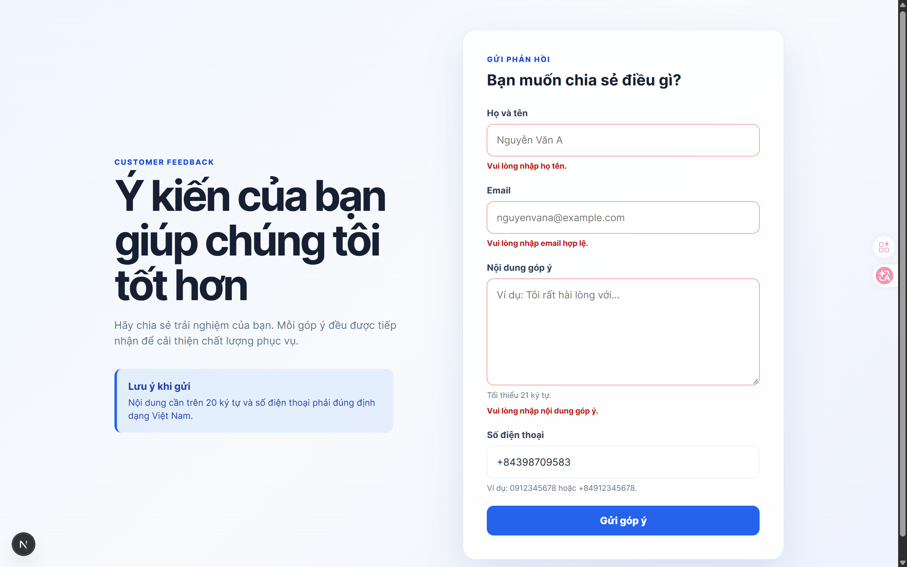
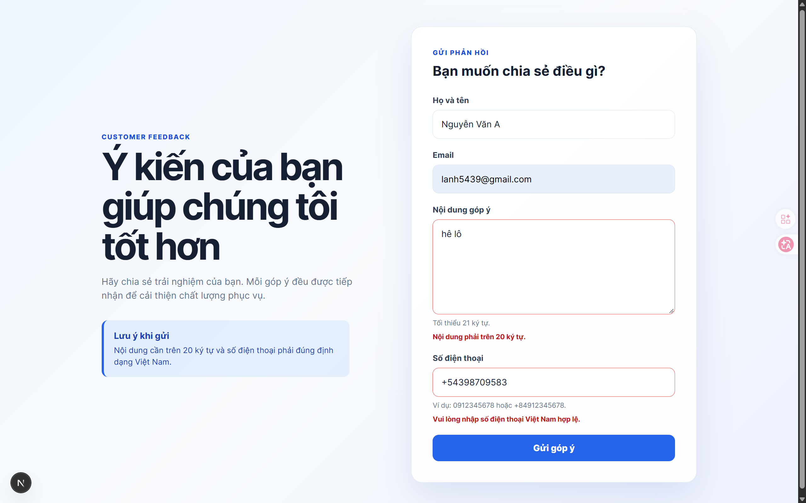
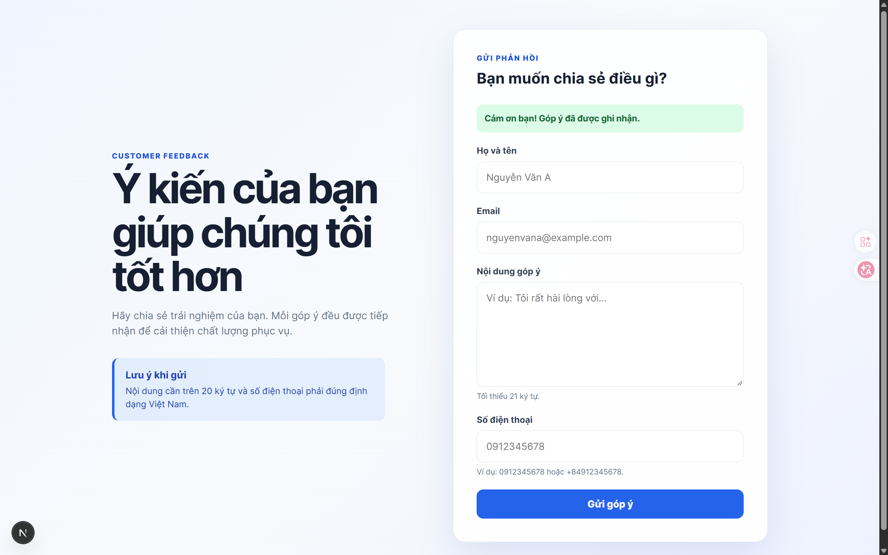

# Customer Feedback Form
N23DCPT033 - PHÙNG ANH LỰC

## Chức năng

- Kiểm tra nội dung phải **trên 20 ký tự**.
- Kiểm tra họ tên là bắt buộc.
- Kiểm tra email đúng định dạng.
- Kiểm tra số điện thoại theo định dạng số điện thoại Việt Nam.
- Hiển thị thông báo lỗi riêng cho từng trường.
- Kiểm tra lại dữ liệu trong Server Action trước khi chấp nhận.
- Hiển thị thông báo thành công và xóa form sau khi gửi hợp lệ.

## Chạy dự án

Yêu cầu Node.js 20 trở lên.

```powershell
npm install
npm run dev
```

Mở [http://localhost:3000/feedback](http://localhost:3000/feedback).

## Kiểm thử thủ công

1. Để trống nội dung hoặc nhập tối đa 20 ký tự: phải thấy lỗi nội dung.
2. Để trống họ tên hoặc nhập email như `invalid-email`: phải thấy lỗi tương ứng.
3. Nhập nội dung hợp lệ nhưng dùng số điện thoại như `12345`: phải thấy lỗi số điện thoại.
4. Nhập đầy đủ dữ liệu hợp lệ và số như `0912345678`: phải thấy thông báo gửi thành công.
5. Chạy kiểm tra kiểu và build production:

```powershell
npm run typecheck
npm run build
```

Kế hoạch triển khai chi tiết nằm trong [roadmap.md](./roadmap.md).

## Bảng test case

| Mã | Dữ liệu kiểm thử | Kết quả mong đợi |
|---|---|---|
| TC01 | Nội dung rỗng | Báo lỗi bắt buộc nhập |
| TC02 | Nội dung 20 ký tự | Báo lỗi chưa đủ độ dài |
| TC03 | Nội dung 21 ký tự | Hợp lệ |
| TC04 | Email `invalid-email` | Báo lỗi email |
| TC05 | Số điện thoại `0123456789` | Báo lỗi số điện thoại |
| TC06 | Số điện thoại `0912345678` | Hợp lệ |
| TC07 | Nội dung và số điện thoại cùng sai | Hiển thị đồng thời hai lỗi |
| TC08 | Tất cả dữ liệu hợp lệ | Gửi thành công |

## Ảnh minh chứng kiểm thử

Các ảnh dưới đây được chụp từ form thực tế:

### TC01 - Nội dung chưa đủ 21 ký tự



### TC07 - Nhiều lỗi validation cùng lúc



### TC08 - Gửi form thành công




